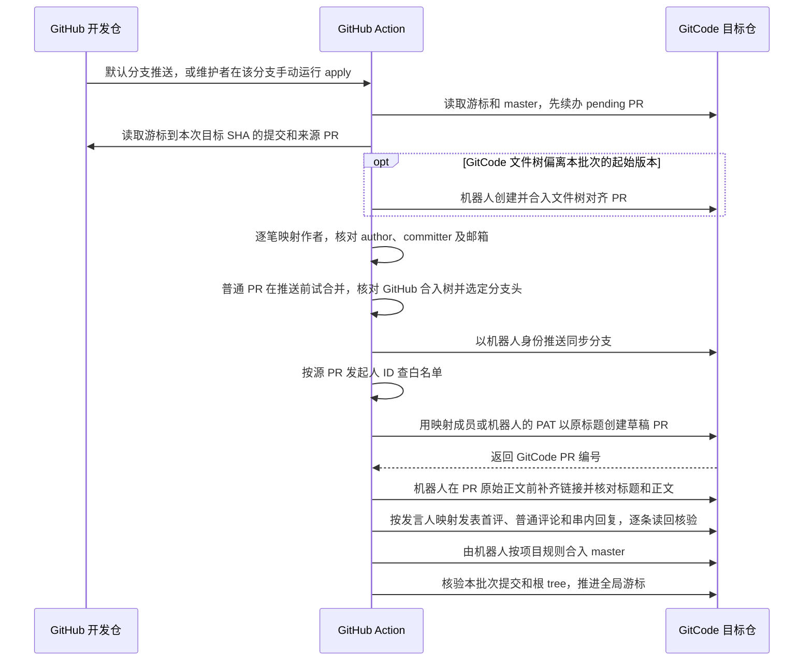
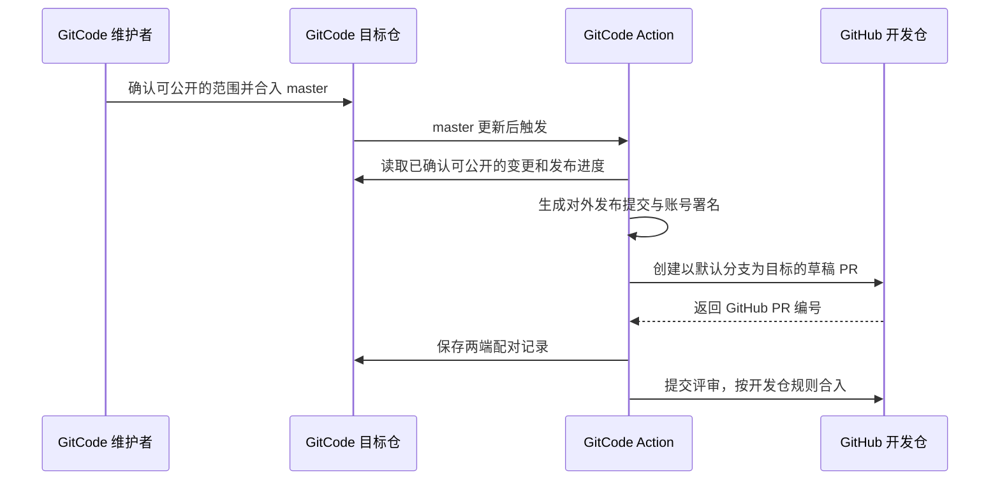
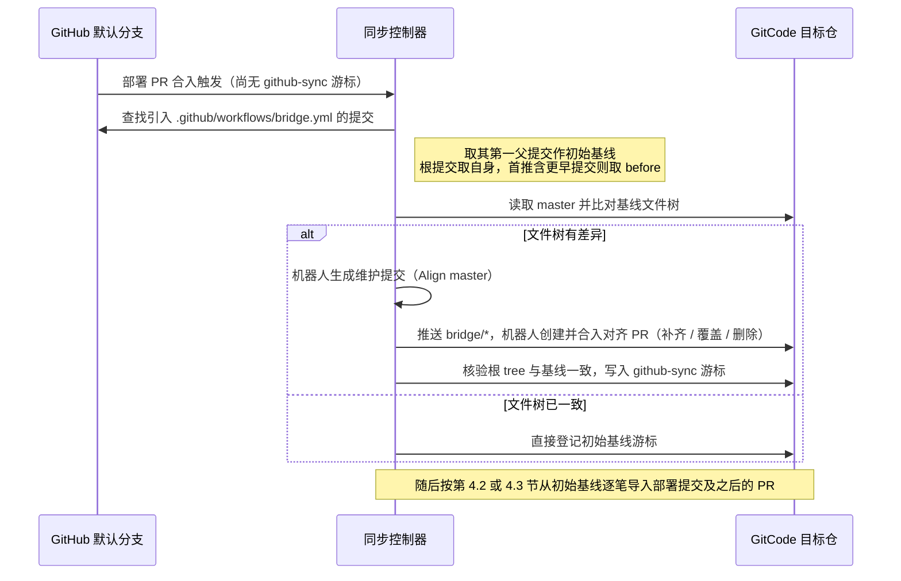
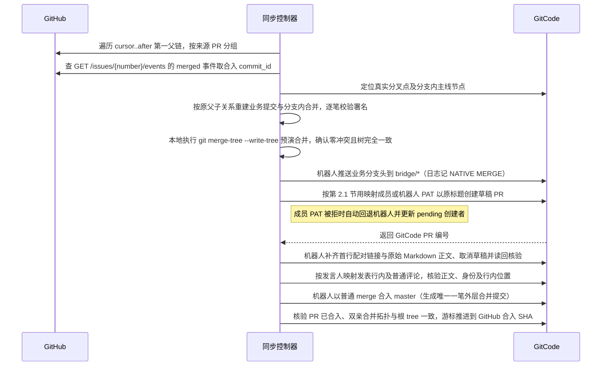
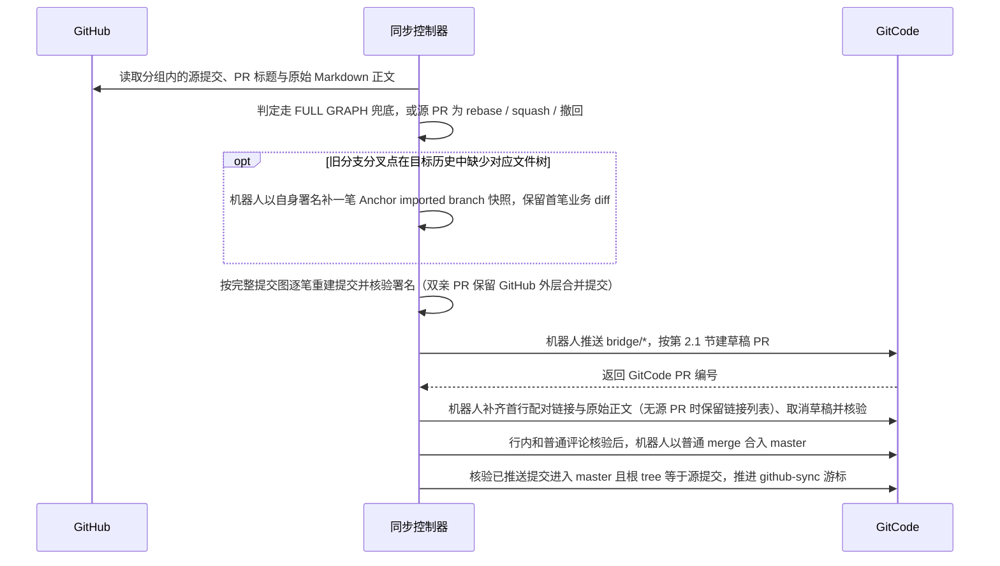
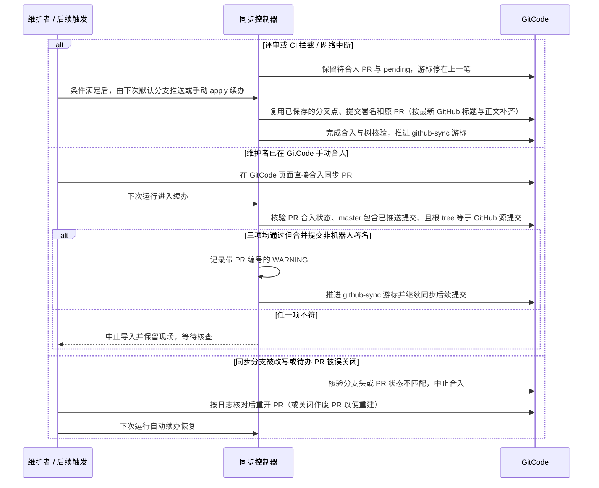

# GitHub → GitCode 单向同步

**为解决GitCode白盒所需的commit/comment数据而生。**

**不想了解原理，那就直接看第七章！！！**

## 1. 同步范围

- 推送到 GitHub 默认分支时自动同步。漏掉的推送可由下次推送补齐，也可在 Actions 中[手动补齐](#61-漏推与中断后的补同步)
- GitCode 机器人通过 PR 把新提交合入 `master`。有来源 GitHub PR 时，GitCode 沿用其标题和 Markdown 正文，在正文首行加上 GitHub 与 GitCode 的配对链接。
- 配对 GitCode PR 合入前，同步 GitHub PR 的 Conversation 留言、已提交的 Review 和代码讨论，包括同一讨论串的多轮回复。 
- GitCode → GitHub 的未来发布流程见第 3.2 节。

## 2. 账号白名单

PR 发起人、评论发言人和每笔提交的作者共用仓库里的 `.github/gitcode-members.json`。创建 GitCode PR 时按 GitHub **源 PR 发起人**的 `user.id` 查表，发表评论时按该条留言、Review、首评或回复发言人的 `user.id` 查表。导入每笔提交时独立按该提交的 `author.id` 查表。[GitHub PR 接口](https://docs.github.com/en/rest/pulls/pulls#get-a-pull-request) · [GitHub 提交接口](https://docs.github.com/en/rest/commits/commits#get-a-commit)

| GitHub 提交归属 | 导入提交的 `author` 和 `committer` | 同步分支推送与自动合入 |
|---|---|---|
| 作者 ID 命中映射且本人凭证可用 | 两者均使用对应的 GitCode 用户名和已绑定邮箱 | GitCode 机器人 |
| 作者未映射、未关联账号，或成员凭证不可用 | 两者均使用 GitCode 机器人的用户名和已绑定邮箱 | GitCode 机器人 |

### 2.1 GitCode PR 创建者与合入者

| 来源 | GitCode PR 创建者 | 使用的凭证 |
|---|---|---|
| GitHub PR 发起人 ID 命中映射且本人 PAT 可用 | 该行的 GitCode 账号 | 此成员的个人 PAT |
| 发起人未映射、账号已删除或成员 PAT 不可用 | 机器人 | 机器人 PAT |
| 没有关联 GitHub PR 的直接推送、首次对齐或修复文件树 | 机器人 | 机器人 PAT |

## 3. 同步流程

### 3.1 GitHub → GitCode



例如，GitHub PR #15 的标题是 `[docs] Verify mapped and fallback commit attribution`，GitCode PR #17 使用相同标题。若源描述含以下两段，GitCode 保存的 Markdown 为

```markdown
[GitHub PR #15](https://github.com/example/project/pull/15) <-> [GitCode PR #17](https://gitcode.com/example/project/pull/17)

## Verification

- Check the mapped commit.
- Check the fallback commit.
```

### 3.2 GitCode → GitHub（未来架构）

本节为未来设计。当前 GitCode `master` 会按 GitHub 覆盖，待对外发布的 GitCode 独有内容应保存在单独分支。未来启用反向发布前，需先协调两个方向的写入时机。届时复用第 3.1 节的 GitHub 开发仓，由 GitCode Action 在托管 Runner 上把获准公开的变更提交为 GitHub PR，沿用该仓现有的合入规则。[GitCode 触发事件](https://docs.gitcode.com/docs/help/home/org_project/pipeline/syntax-reference/trigger-events/) · [GitCode 托管 Runner](https://docs.gitcode.com/docs/help/home/org_project/pipeline/runner-management/using-hosted-runners/)



## 4. 分支、提交和 commit message

无论走哪条路径，每笔业务提交均遵循统一的保真规则：直接使用源提交的 `tree`，保留 commit message 原始字节（含多行正文、尾注）及两个原始时间戳与时区；维护类提交（首次基线对齐、`Anchor imported branch` 分叉点快照）两处均为机器人账号。下文按 4 种典型场景分别给出同步时序。[导入逻辑](.github/workflows/bridge/import_plan.py) · [GitHub 合入事件](https://docs.github.com/en/rest/using-the-rest-api/issue-event-types#merged) · [Git 合并预演](https://git-scm.com/docs/git-merge-tree) · [GitCode 合并接口](https://docs.gitcode.com/docs/apis/put-api-v-5-repos-owner-repo-pulls-number-merge/)

### 4.1 首次自动对齐（尚无 `github-sync` 游标）



### 4.2 常规合并 PR（`NATIVE MERGE`，主路径）

适用于 GitHub 普通双亲 merge PR，且真实分叉点可在 GitCode 历史中唯一确认、本地试合并无冲突且结果树与 GitHub 逐字节一致的场景（上线后日常新 PR 均走此路径，只产生 GitCode 唯一一次外层合并）。



### 4.3 完整提交图兜底（`FULL GRAPH`）与非合并合入（rebase / squash / 撤回）

适用于两类情况：① 普通合并 PR 但历史分叉点无法确认（如上线前拉出的旧分支）、本地试合并冲突，或 GitHub 合入时有手工改动（日志记 `FULL GRAPH`）；② rebase merge（逐笔保留）、squash merge（同步进入默认分支的一笔）或撤回 PR。



### 4.4 拦截、中断续办与人工合入恢复

每次建分支前都会先把 `pending`（含分叉点、提交署名、创建者与 PR 编号）写入 `github-sync`，升级前已打开的同步 PR 也按原提交图继续完成。



## 5. 前置条件/使用方法

### 5.1 需要准备的资源

- **GitHub 开发仓**保护默认分支，保留开发 PR 的评审与 CI 规则。
  - 建议对 `master` 禁止强推，使用分支保护时可核对 `Allow force pushes` 是否关闭。
- **GitCode 目标仓（公开或私有）**已有 `master` 并启用 PR。允许机器人创建 `bridge/*` 同步分支并维护 `github-sync`。
  - 要自动合入，在 `master` 的保护规则中授权机器人合并 PR。
  - 由机器人创建 PR 时，还需按项目设置允许机器人合入自己创建的 PR。其他审核与 CI 要求由 GitCode 仓库规则决定。
- **GitCode 机器人**使用专用 GitCode 普通账号并加入业务仓。
- **白名单成员**需要访问目标仓、创建 PR、发表行内及普通评论的权限，并授权工作流使用本人的 PAT。

### 5.2 配置需求

**第七章中会详细讲这些需求会被怎样应用：**

| 凭证或配置 | 配置位置 | 所需权限与用途 |
|---|---|---|
| GitHub 仓库维护者 | GitHub 开发仓 | 仓库所有者或管理员负责配置部署环境和 Secrets |
| `GITCODE_ROBOT_TOKEN` | GitHub 开发仓的 `gitcode-sync` 环境 Secret | GitCode 机器人 PAT，可读账号资料、已确认邮箱和目标仓，可推送同步分支与 `github-sync`，并创建、读取、更新和合并 PR，以及读取和发表行内及普通评论 |
| 成员 Secret，如 `GITCODE_MEMBER_EXAMPLE_TOKEN` | GitHub 开发仓的 `gitcode-sync` 环境，每个映射账号一个 | 填该成员的 GitCode PAT，授权读取账号资料、在目标项目创建 PR、发表行内及普通评论。名称由该成员的 `gitcode_pr_token_secret` 指定 |
| `GITCODE_SYNC_CONFIG_JSON` | GitHub 开发仓的 `gitcode-sync` 环境 Secret | JSON 只含 `gitcode.repo` 和 `gitcode.bot`（ID、用户名、提交邮箱）。[私有配置示例](bridge.example.json) |
| `.github/gitcode-members.json` | GitHub 开发仓，随 PR 评审 | 两端账号 ID、用户名、成员 PAT 的 Secret 名。[成员映射](.github/gitcode-members.json) |

### 5.2 Action操作--漏推与中断后的补同步

如果一次推送漏触发，或 GitCode PR 因评审、CI 或网络中断而停下，下次默认分支推送会从已保存的游标继续。**如果短期内没有新推送，维护者可手动补同步，等待本身不会产生运行：**

1. 在部署了工作流的 GitHub 源仓库打开 **Actions → Sync merged code → Run workflow**，分支选 `master`。
2. 要执行补同步，将操作从默认的 `check` 改为 `apply`，再点 **Run workflow**。若只想看差异，可直接运行 `check`。它会预览结果，GitCode 和游标均保持原状。[GitHub 手动运行指南](https://docs.github.com/en/actions/how-tos/manage-workflow-runs/manually-run-a-workflow)
3. 打开该次运行的 **Apply the selected operation** 日志。有新提交时，`VERIFIED master tree matches GitHub` 表示文件树已核验。目标已同步时会显示 `CURRENT`。

## 7. 配置方式

**按一下方式进行配置即可：**

0. 先通过反合代码，将两仓的master分支对齐。

1. 注册一个专用 GitCode 机器人账号并确认邮箱（建议保持 GitCode 昵称与用户名一致，避免正常合入时触发合并提交署名告警）。请目标仓管理员邀请该账号加入，并在账号接受邀请后授予维护者权限。

2. 用本项目的配置模板准备部署配置。需要填写目标仓库、机器人账号 ID、登录名和已绑定的提交邮箱。可以用下面的提示词生成配置。

    ```text
    请按本目录的 bridge.example.json 生成部署配置。GitHub 源仓库为 <GITHUB_OWNER>/<GITHUB_REPO>，GitCode 目标仓库为 <GITCODE_OWNER>/<GITCODE_REPO>，机器人主页为 <GITCODE_BOT_PROFILE_URL>。请根据项目文档生成 GITCODE_SYNC_CONFIG_JSON 的值，准备部署 PR，并列出由仓库维护者操作的设置步骤。
    ```

    - 每次同步，机器人会自动创建一个形如 `bridge/github-<源提交短 SHA>-<同步提交短 SHA>` 的分支，把这批代码推上去。对应的 GitCode PR 从这个分支合入 `master`，合入时工作流会请求删除临时分支。

3. 在 GitHub 创建环境并填写 Secrets，打开 **Settings → Environments → New environment**，创建 `gitcode-sync`。在 **Deployment branches and tags** 选择 **Selected branches and tags**，添加类型为 **Branch**、名称为 `master` 的规则。然后在该页的 **Environment secrets → Add secret** 逐项填写。

    - 用机器人账号登录 GitCode，在「个人设置 → 访问令牌 → 新建访问令牌」[创建机器人 PAT](https://gitcode.com/setting/token-classic)。机器人需要读取账号资料、已确认邮箱和目标仓，推送同步及状态分支，读写 PR、行内及普通评论，并按仓库规则合入。注明 Secret 名 `GITCODE_ROBOT_TOKEN`，随后把Token填入。
    - 根据2生成的JSON配置，配置`GITCODE_SYNC_CONFIG_JSON`。
    - 按配置好的成员映射，为每个人添加同名环境 Secret，值填该成员本人的 GitCode PAT。[成员映射示例](.github/gitcode-members.json)

4. 向团队成员获取GitCode信息，用来将Github提交映射至GitCode，可以用以下AI提示词，让成员的agent完成此事(前两行的URL换成自己的)：

```text
GitHub 主页 <GITHUB_PROFILE_URL>
GitCode 主页 <GITCODE_PROFILE_URL>

请根据这两个主页查询账号信息，生成一条 GitHub → GitCode 成员映射。

1. 从各自的主页链接提取用户名，分别查询官方用户接口。
   GitHub 用 GET https://api.github.com/users/<GitHub用户名>
   GitCode 用 GET https://api.gitcode.com/api/v5/users/<GitCode用户名>
2. 两个平台都取接口返回的 id 和 login。把 id 写成 JSON 字符串，把 login 原样填入 username，保留大小写。
3. 两边都查到后，只输出下面结构的 JSON，用实际查询结果替换占位符。

{
  "github": {"id": "<GitHub账号ID>", "username": "<GitHub登录名>"},
  "gitcode": {"id": "<GitCode账号ID>", "username": "<GitCode登录名>"}
}

如果任一查询失败，请指出失败的平台和原因。
```

5. 将 `.github/gitcode-members.json` 中的示例替换为实际成员映射，并把每位成员的 Secret 名填入 `gitcode_pr_token_secret`。在 `.github/workflows/bridge.yml` 的 `env` 中为每个 Secret 添加同名引用。成员映射示例如下。

   ```text
    {
       "github": {"id": "00000000", "username": "example-github-user"},
       "gitcode": {"id": "example-gitcode-id", "username": "example-gitcode-user"},
       "gitcode_pr_token_secret": "GITCODE_MEMBER_EXAMPLE_TOKEN"
     },
   ```

6. 打开 GitHub 源仓库的 **Settings → Environments → gitcode-sync**，在 **Environment secrets → Add secret** 逐项填写。

   - 为第五步中每个 Secret 名填写对应成员的 GitCode PAT。

7. 上面做完，将修改同步至 PR，随后进行合入。`.github/workflows/bridge.yml` 本身就是 Action 配置，合入后立即启动自动同步。可在 Actions 运行日志中核对 `NATIVE MERGE ... | verified GitCode merge tree`（常规新 PR 走单层原生合入；仅上线前遗留旧分支或冲突合并会打印 `FULL GRAPH` 走完整提交图兜底）。
